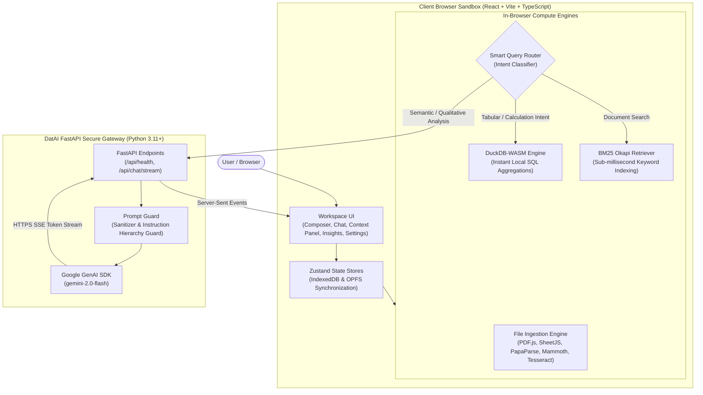

<div align="center">

# 🎓 DatAI — College AI Chatbot & File Intelligence Workspace

[](LICENSE)
[](https://react.dev/)
[](https://fastapi.tiangolo.com/)
[](https://duckdb.org/)
[](https://ai.google.dev/)
[](https://render.com/)

**A privacy-preserving, evidence-grounded AI file intelligence workspace and chatbot designed for students, educators, and researchers.**  
*Analyze complex PDFs, research papers, lecture notes, and large spreadsheets with in-browser DuckDB-WASM SQL processing and secure Google Gemini reasoning.*

[🚀 Quick Start](#-quick-start) • [✨ Key Features](#-key-features) • [🏛️ Architecture](#%EF%B8%8F-system-architecture) • [🌐 Deploy to Render](#-deploy-to-render) • [🧪 Testing](#-testing)

---

</div>

## 📖 Overview

**DatAI (College AI Chatbot)** bridges the gap between conversational AI and rigorous, evidence-based academic research. When students and researchers upload documents or datasets to traditional chatbots, they face two major problems:
1. **Privacy & Data Security Risks**: Uploading proprietary research, student records, or exam datasets to public cloud servers.
2. **AI Math Hallucinations**: Standard LLMs often guess numerical totals, averages, and statistical aggregations rather than calculating them accurately.

DatAI solves both challenges with a **Local-First, Hybrid-Compute Architecture**:
- **Browser-Sandbox Processing**: Files (PDFs, DOCX, CSV, Excel, Images) are parsed and indexed locally in the user's browser using **IndexedDB** and the **Origin Private File System (OPFS)**.
- **Accurate Mathematical Aggregations**: Spreadsheets are queried directly inside the browser using **DuckDB-WASM** (running real analytical SQL).
- **Privacy-Preserving AI Gateway**: When high-level reasoning is needed, only a minimal, sanitized snippet of extracted text is streamed to Google Gemini via a secure **FastAPI** gateway. Raw documents never leave the client.

---

## ✨ Key Features

### 📁 1. Universal Multi-Format Document Ingestion
- **PDF Documents**: Extracted page-by-page via `pdfjs-dist` with preserved layout and coordinates.
- **Word Documents (`.docx`)**: Structured paragraph, heading, and table extraction with `mammoth`.
- **Spreadsheets (`.csv`, `.xlsx`, `.xls`)**: High-speed chunking and schema inference using SheetJS (`xlsx`) and `papaparse`.
- **Image OCR**: In-browser client-side optical character recognition via `tesseract.js`.
- **Text & Code**: Markdown, plain text, and source code files.

### ⚡ 2. In-Browser DuckDB-WASM Analytics
- Runs full analytical SQL queries directly on spreadsheets inside the browser.
- Calculates exact aggregations (SUM, AVG, MIN/MAX, COUNT, GROUP BY, TOP N, Trends) with **zero LLM math hallucinations**.
- Fast table virtualization capable of rendering **50,000+ rows at 60 FPS** using `@tanstack/react-virtual`.

### 📊 3. Dynamic Visualizations
- Automatically suggests and renders interactive charts derived from data queries using **Recharts**.
- Supports Bar Charts, Line Charts, Area Trends, and Pie distributions with dark/light theme awareness.

### 🎯 4. Evidence-Grounded Citations
- Every response provides verifiable source coordinates: **File Name**, **Sheet/Table**, **Row Range**, or **Page Number**.
- Click any citation to instantly highlight the exact source snippet in the interactive Context Panel.

### 🛡️ 5. Zero-Trust Prompt Guard
- Protects against malicious prompt injections hidden inside untrusted files (e.g. *"Ignore all previous instructions..."*).
- Enforces strict operational hierarchy:
  ```
  SYSTEM DIRECTIVE > APPLICATION RULES > USER QUERY > RETRIEVED CONTEXT (UNTRUSTED)
  ```

### 🔍 6. Hybrid BM25 Retrieval
- Inverted index search powered by **BM25 Okapi** and Reciprocal Rank Fusion (RRF).
- Retrieves relevant sections in sub-millisecond speeds without external vector database dependencies.

### 📋 7. Privacy Dashboard & Cloud Audit Trail
- Real-time transparency log detailing every external request to Google Gemini.
- Displays payload preview, token count estimates, latency, model used, and response status.

### 👑 8. Super Admin Console & Open User Registration
- **Open Registration**: Any student, researcher, or educator can sign up and start analyzing documents immediately.
- **Default Super Admin**: Pre-configured Super Admin account (`admin@college.edu`) with 1-click login and full administrative rights.
- **Full User Management**: Inspect all registered accounts, elevate roles (`Super Admin`, `Admin`, `Student/User`), toggle account status (`Active`/`Suspended`), reset query quotas, and add custom users.

### ⚡ 9. ChatGPT-Style AI Query Rate Limiting
- **Guest In-Browser Queries**: Unauthenticated visitors can ask free questions (default: 5) to explore the system before being prompted to sign up or sign in.
- **ChatGPT-Style Barrier Dialog**: Reaching the limit presents an elegant modal prompting users to "Create Free Account", "Sign In", or "⚡ Continue as Super Admin".
- **Dynamic Live Quota Indicators**: The chat composer displays real-time query counts (e.g. `⚡ 18/25 Left Today` or `👑 Super Admin • Unlimited`).
- **Super Admin Limit Controls**: Super Admin can live-adjust guest limits, daily user quotas, toggle guest access, or override quotas for specific users.

### 🌓 10. Modern Obsidian / Slate Theme Engine
- Seamless, instant toggling between high-contrast **Obsidian Dark Mode** and crisp **Slate Light Mode**.
- Synchronous pre-hydration script eliminates dark/light mode flashing on initial page load.

---

## 🏛️ System Architecture



---

## 🛠️ Technology Stack

| Layer | Technologies | Purpose |
| :--- | :--- | :--- |
| **Frontend UI** | React 18, TypeScript, Tailwind CSS, Lucide Icons | Responsive, glassmorphic research interface |
| **Client State & DB** | Zustand, `idb` (IndexedDB), OPFS | Reactive state and client-side document persistence |
| **Data Engine** | `@duckdb/duckdb-wasm`, SheetJS, PapaParse | In-browser analytical SQL engine and spreadsheet parsing |
| **Document Processing** | `pdfjs-dist`, `mammoth`, `tesseract.js` | PDF extraction, DOCX conversion, and image OCR |
| **Search Engine** | BM25 Okapi inverted index | Millisecond local chunk search |
| **Visualizations** | Recharts, `@tanstack/react-virtual` | Interactive data charts and virtualized high-volume tables |
| **Backend Gateway** | Python 3.11+, FastAPI, Uvicorn, Gunicorn | Lightweight proxy protecting `GEMINI_API_KEY` |
| **AI Orchestration** | `google-genai` (Gemini 2.5 Flash), `sse-starlette` | High-speed Server-Sent Events token streaming |
| **Deployment** | Render Blueprint (`render.yaml`), Docker (Multi-stage) | Automated cloud deployment with 1-click support |

---

## 📁 Repository Structure

```
├── client/                     # React Vite Frontend Application
│   ├── public/
│   │   ├── _headers            # Cross-Origin Isolation headers for DuckDB-WASM
│   │   ├── _redirects          # SPA client-side routing fallback rule
│   │   └── manifest.webmanifest# PWA manifest
│   ├── src/
│   │   ├── components/         # React components (Chat, Analytics, Files, Privacy, Settings)
│   │   ├── lib/
│   │   │   ├── ai/             # Gemini Gateway & local providers
│   │   │   ├── analytics/      # DuckDB client & analytical query planner
│   │   │   ├── parsers/        # PDF, DOCX, CSV, Excel & OCR ingestion
│   │   │   ├── router/         # Smart Query Router (Intent classifier)
│   │   │   ├── search/         # Hybrid BM25 Okapi retriever
│   │   │   └── storage/        # IndexedDB storage layer
│   │   ├── store/              # Zustand state stores (settings, chat, files, workspace)
│   │   └── types/              # TypeScript interface definitions
│   └── package.json            # Client dependencies & scripts
├── server/                     # FastAPI Python Backend Gateway
│   ├── routers/
│   │   ├── chat.py             # SSE Chat streaming router (/api/chat/stream)
│   │   └── health.py           # Health check endpoint (/api/health)
│   ├── services/
│   │   ├── gemini_service.py   # Google GenAI client streaming implementation
│   │   └── prompt_guard.py     # Prompt injection sanitizer & context wrapper
│   ├── tests/
│   │   └── test_gateway.py     # Pytest test suite (health, security, prompt guard)
│   ├── config.py               # Dynamic settings (CORS, static dir, port)
│   ├── main.py                 # FastAPI application & SPA static server
│   └── requirements.txt        # Python backend dependencies
├── docs/                       # Technical & architectural specifications
│   ├── ARCHITECTURE.md         # Full system architecture
│   ├── RENDER_DEPLOYMENT.md    # Detailed Render cloud deployment guide
│   ├── SECURITY.md             # Threat model & prompt guard specs
│   └── AI_ROUTING.md           # Query router decision tree
├── Dockerfile                  # Multi-stage Dockerfile for unified deployment
├── render.yaml                 # Render Infrastructure-as-Code Blueprint
├── build.sh                    # Unified build script for Render
└── package.json                # Root workspace configuration
```

---

## 🚀 Quick Start

### Prerequisites
- **Node.js**: v18.0.0 or higher
- **Python**: v3.10, v3.11, or v3.12
- **Google Gemini API Key**: Obtainable for free at [Google AI Studio](https://aistudio.google.com/)

---

### Step 1: Clone the Repository
```bash
git clone https://github.com/surya7989/college-ai-chatbot.git
cd college-ai-chatbot
```

### Step 2: Configure Backend Gateway
```bash
cd server

# Create and activate virtual environment
python -m venv .venv
# On Windows:
.venv\Scripts\activate
# On Linux / macOS:
source .venv/bin/activate

# Install dependencies
pip install -r requirements.txt

# Create .env file with your API key
copy .env.example .env   # On Linux/macOS: cp .env.example .env
```

Open `server/.env` and insert your Gemini API Key:
```env
GEMINI_API_KEY=AIzaSy...your_gemini_api_key_here
DEFAULT_MODEL=gemini-2.0-flash
HOST=0.0.0.0
PORT=8000
CORS_ORIGINS=*
```

Start the FastAPI gateway:
```bash
uvicorn main:app --reload --port 8000
```
Verify the gateway is live by opening: `http://localhost:8000/api/health`

---

### Step 3: Configure Frontend Client
In a new terminal:
```bash
cd client

# Install client dependencies
npm install

# Start Vite development server
npm run dev
```

Open your browser at: **`http://localhost:5173`**

*(Note: You can also enter or override your Gemini API Key directly in the web app under **Settings** ➔ **Google Gemini API Key**).*

---

## 🌐 Deploy to Render

DatAI is pre-configured for deployment on [Render](https://render.com) using **Infrastructure as Code (Render Blueprint)** or a **Single Docker Container**.

### Option A: 1-Click Render Blueprint (Recommended)
This deploys the backend as a Python Web Service and the frontend as a **Render Static Site** (which is 100% free and has **zero cold-starts**):

1. Push your repository to GitHub.
2. In the [Render Dashboard](https://dashboard.render.com), click **New +** ➔ **Blueprint**.
3. Select your `college-ai-chatbot` repository. Render automatically detects [`render.yaml`](render.yaml).
4. When prompted, enter your `GEMINI_API_KEY`.
5. Click **Apply**. Render will automatically provision both services and link them together!

---

### Option B: Single Fullstack Service via Docker
This compiles the React frontend and packages it into a single Python FastAPI web service (1 URL, 0 CORS issues, fits in Render's 1 free Web Service allowance):

1. In Render Dashboard, click **New +** ➔ **Web Service**.
2. Select your repository and choose **Docker** runtime.
3. Under **Environment Variables**, add:
   - `GEMINI_API_KEY`: Your Gemini API key.
4. Click **Create Web Service**.

> 💡 For comprehensive setup instructions, custom domains, and troubleshooting, read the **[Render Deployment Guide](docs/RENDER_DEPLOYMENT.md)**.

---

## 🧪 Testing

### Backend Gateway Tests (Pytest)
```bash
pytest server/tests
```
Verifies health checks, prompt injection sanitization, instruction hierarchy, CORS, and Cross-Origin Isolation headers.

### Frontend TypeScript & Bundle Check
```bash
cd client
npm run build
```
Executes type-checking via `tsc` and compiles the optimized Vite bundle into `client/dist/`.

---

## 🔒 Security & Privacy Guarantees

1. **Local-First Storage**: Document contents are stored in browser IndexedDB/OPFS. Nothing is sent to third-party databases.
2. **Context Minimization**: Only the specific relevant paragraph chunks needed to answer a query are sent to the AI model.
3. **Cross-Origin Isolation**: Protected with `Cross-Origin-Opener-Policy: same-origin` and `Cross-Origin-Embedder-Policy: credentialless` to prevent cross-origin memory leaks while enabling high-performance WebAssembly.
4. **Transparent Auditing**: Every outgoing prompt and context payload is recorded in the local Audit Log accessible directly from the application UI.

---

## 📄 License

This project is licensed under the **MIT License**. See the [LICENSE](LICENSE) file for details.

---

<div align="center">
  <sub>Built with ❤️ for privacy-first education and research.</sub>
</div>
